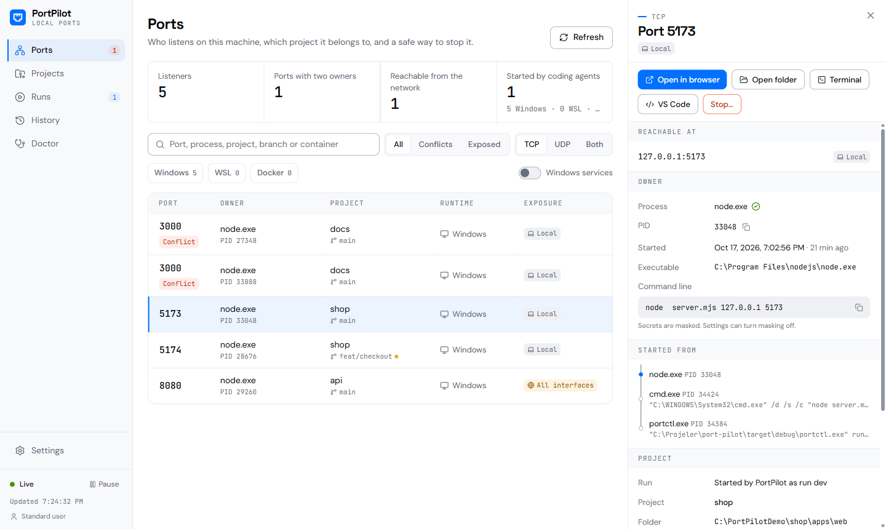
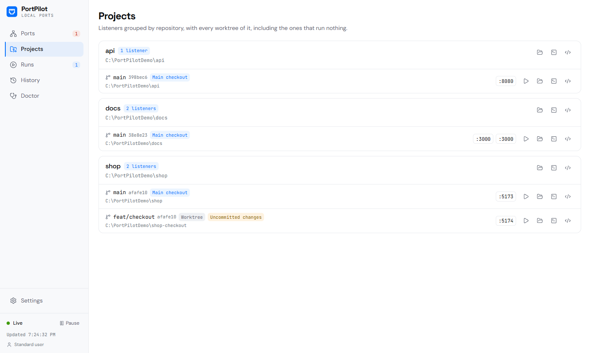
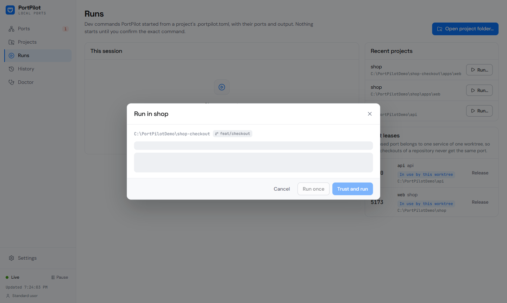
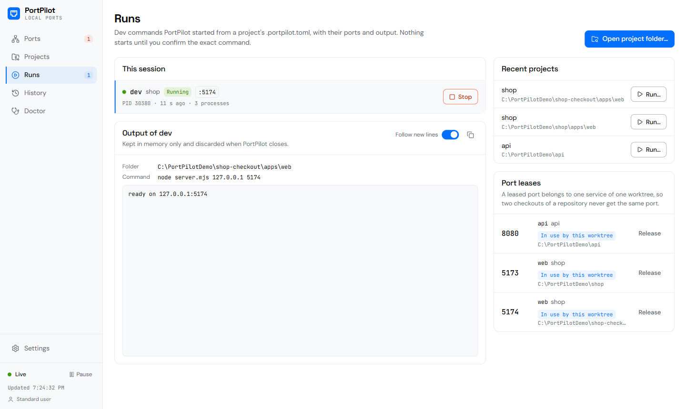

# PortPilot

PortPilot, Windows'taki her yerel geliştirme portunu açıklar: onu hangi süreç dinliyor, hangi projeye, Git worktree'sine, WSL dağıtımına ya da Docker container'ına ait, kim başlattı ve yanlış sürece dokunmadan nasıl durdurulur. Bildirim alanı simgesi olan bir masaüstü uygulaması ve aynı motoru kullanan `portctl` komut satırı aracından oluşur.

[English](README.md) · [Nasıl çalışır](docs/architecture.md) · [CLI başvurusu](docs/cli.md) · [Güvenlik ve gizlilik](docs/security.md) · [SSS](docs/faq.md)

> Durum: `0.1.0-alpha.1`, ilk kilometre taşı ("Her yerel geliştirme portunu açıkla"). Asıl hedef Windows 11; Windows 10'da elden geldiğince çalışır.

<picture>
  <source media="(prefers-color-scheme: dark)" srcset="docs/screenshots/ports-dark.png">
  
</picture>

## Neye cevap verir

"3000 portunda bir şey var" yalnızca belirtidir. PortPilot arkasındaki soruları cevaplar:

- **Sahibi kim.** Port, bağlanılan adres ve erişim (yalnızca yerel, tek ağ, tüm arabirimler); PID'si *ve* oluşturulma zamanıyla sahibi olan süreç, programı, komut satırı, kullanıcısı ve onu başlatan üst süreç zinciri.
- **Hangi proje.** Proje klasörü ve Git deposu, dalı, commit'i, commit edilmemiş değişiklikler ve bağlı bir worktree olup olmadığı. Her eşleştirme nasıl yapıldığını söyler: *kesin* (WSL çalışma klasörü, Compose etiketi) ya da *çıkarım* (komut satırındaki bir yol, programın klasörü). Windows'ta başka bir sürecin çalışma klasörünü okuyan genel bir API yok; PortPilot bilmediğini biliyormuş gibi göstermez.
- **Kim başlattı.** Üst süreç zincirindeki en yakın başlatıcı: Claude, Codex, Gemini CLI, VS Code, Cursor, bir JetBrains IDE'si, bir terminal ya da Windows hizmet yöneticisi.
- **Windows mu, WSL mi, Docker mı.** WSL'in `wslrelay.exe`'si ve Docker Desktop'ın `com.docker.backend.exe`'si başka bir şey için host portu tutar. PortPilot bunları yönlendirdikleri Linux sürecine (çalışan dağıtımlarda `ss` ile okunur) ya da container'a (Docker Engine API'sinden okunur) bağlar; arkasında bir şey olmayan yönlendiricileri, yani klasik "port is already allocated" durumunu işaretler.
- **Port neden kullanılamıyor.** Windows'un ayırdığı aralıklardaki (Hyper-V, WinNAT, WSL ve Docker bloklar ayırır) bir porta, dinleyen olmasa bile bağlanılamaz. `portctl who 3000` ve Tanılama sayfası bunu söyler ve yakındaki boş portları önerir.
- **Çakışmalar.** Aynı portu farklı adreslerde dinleyen iki sahip (örneğin `127.0.0.1:3000` ve `[::1]:3000`); hangisinin yanıt vereceği IPv4 mü IPv6 mı kullanıldığına bağlıdır.

<picture>
  <source media="(prefers-color-scheme: dark)" srcset="docs/screenshots/projects-dark.png">
  
</picture>

## Güvenli durdurma

1. **Önce kimlik.** Bir durdurma isteği kullanıcının gördüğü dinleyiciyi adlandırır. Motor süreci açar ve oluşturulma zamanını gösterilenle karşılaştırır; Windows PID'leri yeniden kullanır, uyuşmazlık her şeyi durdurur. Tutamaç sonuna kadar açık kalır, bu sırada PID yeniden kullanılamaz.
2. **Önce nazik istek.** Pencereli programlara `WM_CLOSE` gider. Konsol programlarına CTRL+C, yok sayılırsa CTRL+BREAK gönderilir; ama yalnızca konsolu hedef, alt süreçleri, paket çalıştırıcısı ve onları başlatan kabuk dışında hiçbir şey kullanmıyorsa. Konsolu bir editör, bir ajan ya da ilgisiz bir program paylaşıyorsa sinyal gönderilmez.
3. **Zorla sonlandırma ayrı bir karardır.** Süreç bekleme süresinden sonra hâlâ çalışıyorsa uygulama yeniden sorar ve zorla sonlandırmanın ne demek olduğunu açıklar; CLI'da `--force` (terminal yoksa `--yes` de) gerekir.
4. **Asla** sistem süreçleri, Windows hizmetleri, WSL ya da Docker yönlendiricileri veya PortPilot'un kendisi. WSL süreçlerine aynı başlama zamanı kontrolünden sonra dağıtım içinde SIGTERM gönderilir; container'lar Docker API'si üzerinden durdurulur.

## Projeleri çalıştırma

Bir proje `.portpilot.toml` tarifiyle buna katılır. PortPilot tarifi yalnızca siz istediğinizde okur (Çalıştır düğmesi, `portctl run`, `portctl lease`) ve bir depodan hiçbir şeyi kendiliğinden çalıştırmaz.

```toml
# .portpilot.toml at the repository root
[project]
name = "shop"

[ports.web]
preferred = 5173
range = "5173-5199"

[ports.api]
preferred = 8080

[run.dev]
command = "pnpm dev --port {ports.web} --strictPort"
cwd = "apps/web"
env = { API_URL = "http://localhost:{ports.api}" }
```

- **Güven sorusu.** İlk seferde PortPilot komutun tam halini, klasörü, ortam değişkenlerini ve portları gösterir ve sorar: *Güven ve çalıştır*, *Bir kez çalıştır* ya da *Vazgeç*. Güvenilen bir komut, tarif onu değiştirene kadar sorusuz çalışır.
- **Yönetilen çalıştırmalar.** Komut, gördüğünüz klasörde, `cmd.exe` ile, kendi süreç grubunda ve bir Windows Job Object içinde çalışır. PID'i, oluşturulma zamanı ve klasörü kaydedilir; dinleyicileri *kesin* olarak bu klasöre bağlanır. Çıktısı Çalıştırmalar sayfası için bellekte tutulur. Durdurma yalnızca çalıştırmanın süreç grubuna CTRL+BREAK gönderir; bütün job'ı sonlandırmak sizin onayınızla olur. PortPilot kapanırsa job çalıştırmayı da sonlandırır.
- **Port kiralamaları.** `{ports.web}` bu depoya, worktree'ye ve servise kiralanmış bir port alır; bir deponun iki worktree'si asla aynı portu almaz. Kiralanan port doluysa PortPilot o worktree için sıradaki boş portu ayırmayı önerir. Yer tutucusu olmayan komutlara port verilmez.
- **Geçmiş.** Çalıştırmaların, kapanışların ve port değişikliklerinin 14 gün tutulan yerel zaman çizelgesi. Siz açmadıkça komut satırı kaydedilmez.



<picture>
  <source media="(prefers-color-scheme: dark)" srcset="docs/screenshots/runs-dark.png">
  
</picture>

Görüntüler `scripts/demo-projects.mjs` ile oluşturulan demo projelerini gösterir; arayüz İngilizce.

## Gizlilik

Telemetri, çökme raporu ya da hesap yok. Tek ağ isteği güncelleme denetimidir: uygulama günde bir kez GitHub'dan en yeni sürümün `latest.json` dosyasını ister, bilgisayar hakkında hiçbir şey göndermez ve yalnızca PortPilot'un anahtarıyla imzalanmış paketleri kurar. Ayarlar'dan kapatılabilir. Komut satırları token, parola ve anahtarlar maskelenerek gösterilir. Yerel geçmiş portları, süreç adlarını ve proje klasörlerini 14 gün tutar; komut satırlarını yalnızca siz açarsanız ve maskeleyerek kaydeder. Başka süreçlerin ortam değişkenleri hiç okunmaz. Ayrıntılar [docs/security.md](docs/security.md) dosyasında.

## Komut satırı

```powershell
portctl list                     # sahip, proje, ortam ve erişimle dinleyiciler
portctl who 3000                 # bir portu açıklar, yakındaki boş portlarla
portctl tree 5173                # komut satırlarıyla bütün üst süreç zinciri
portctl stop 3000                # nazik durdurma; kapanmazsa çıkış kodu 7
portctl stop 3000 --force --yes  # bekleme süresinden sonra sonlandır, sormadan
portctl find --range 3000-3999   # ayrılmış aralıklara göre kontrol edilmiş boş portlar
portctl doctor                   # Windows, Git, WSL, Docker, ayrılmış aralıklar
portctl projects                 # depo ve worktree'ye göre gruplanmış dinleyiciler
portctl run dev                  # güven sorusundan sonra .portpilot.toml'daki [run.dev]'i çalıştırır
portctl lease acquire web        # bu worktree'nin web servisine kiralanan portu yazar
portctl history --kind runs      # son 14 günün çalıştırmaları ve kapanışları
portctl list --json              # sürümlü JSON (schemaVersion 1)
```

Çıkış kodları sabittir: 0 başarılı, 2 geçersiz argüman, 3 dinleyici yok, 4 sahibi belirsiz, 5 erişim reddedildi ya da reddedildi, 6 kimlik değişti, 7 nazik istek zaman aşımı, 8 WSL ya da Docker'a ulaşılamadı, 9 port çakışması, 10 iç hata, 11 tarif yok ya da geçersiz. Bkz. [docs/cli.md](docs/cli.md).

## Kurulum

En son sürümü [GitHub Releases](https://github.com/yusufky63/port-pilot/releases/latest) sayfasından indirin:

| Dosya | Kimin için |
|---|---|
| `PortPilot_<sürüm>_x64-setup.exe` | Yönetici izni istemeden geçerli kullanıcıya kurar. İngilizce ya da Türkçe kurulum. |
| `PortPilot_<sürüm>_x64_portable.zip` | Kurulum yok. Ayarlar exe'nin yanındaki `data` klasöründe durur. `portctl.exe` de içindedir. |
| `SHA256SUMS.txt` | Her dosyanın sağlama toplamı. |

Kurulu kopyalar kendini günceller: yeni bir sürüm çıktığında PortPilot bunu gösterir ve tek tıkla, çalıştırmalarını durdurduktan sonra kurar. Güncelleme yalnızca geçerli bir imzayla kabul edilir. Taşınabilir kopyalar bunun yerine indirme sayfasını açar.

Çalıştırılabilir dosyalar henüz bir sertifikayla kod imzalı değil; SmartScreen ilk açılışta uyarı gösterebilir. İki derleme de Windows 10 ve 11'de zaten bulunan WebView2 çalışma zamanını kullanır.

### Kaynaktan derleme

Rust (stable, MSVC), Node.js 22+, pnpm 9, Git ve Visual Studio C++ derleme araçları kurulu Windows 10 ya da 11.

```powershell
pnpm install
pnpm app:dev                 # anında yenilenen masaüstü uygulaması
cargo run -p portpilot-cli -- list
```

## Lisans

[Apache Lisansı 2.0](LICENSE-APACHE) ya da [MIT lisansı](LICENSE-MIT), tercihinize göre.
